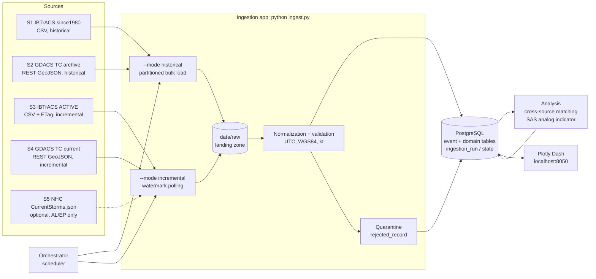

# Architecture Overview (draft)

Adapted from the common technical contract (Docker Compose: database, ingestion application, orchestrator, dashboard). **Check against the reference architecture in the Course Project document.** Rendered image: [`architecture.png`](architecture.png).

| Component | Responsibility | Workshop |
| --- | --- | --- |
| Source adapters (`src/tcmon/sources`) | Download raw responses, parse CSV / GeoJSON / JSON | 1 (done), 2 |
| Raw landing zone (`data/raw`) | Unmodified responses + `.meta.json` | 1 (done) |
| Normalization (`src/tcmon/normalization`) | Canonical event, units, UTC, WGS84 | 1 (draft), 2 |
| Storage (`src/tcmon/storage`, `sql/`) | Upserts, ingestion_run/state, quarantine | 2 |
| Orchestrator | Schedules from `config/sources.yaml` | 3 |
| Analysis | Matching, event groups, SAS indicator | 3, 4 |
| Dashboard (`dashboard/`) | Plotly Dash at localhost:8050 | 4 |
